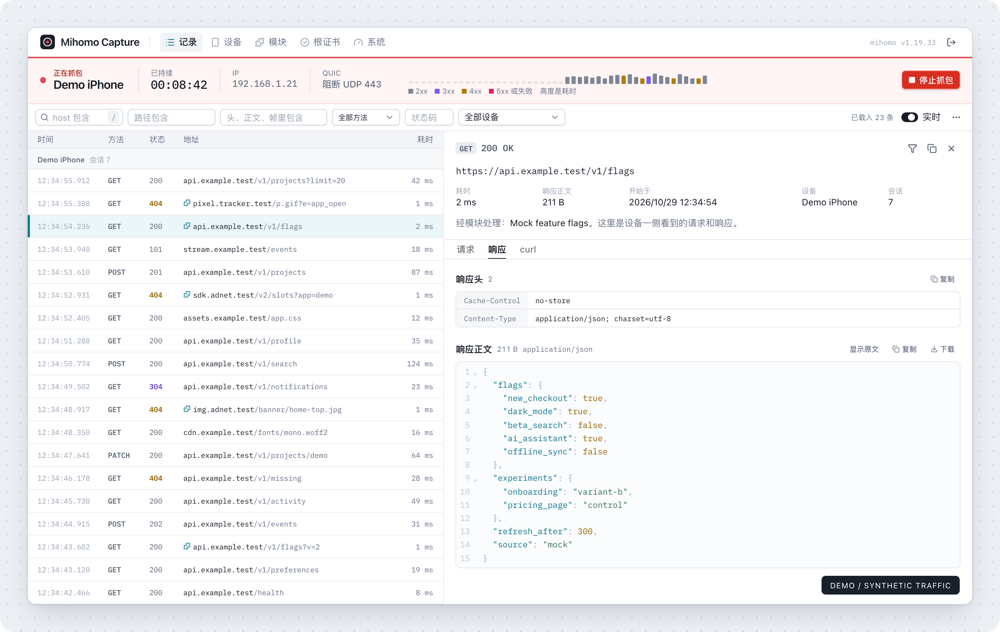
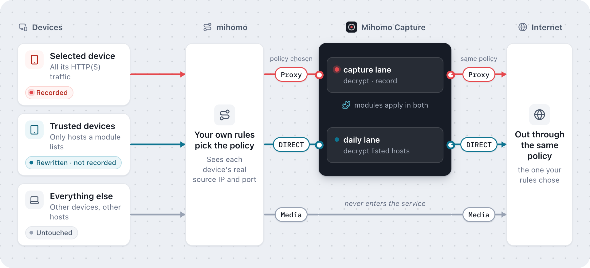
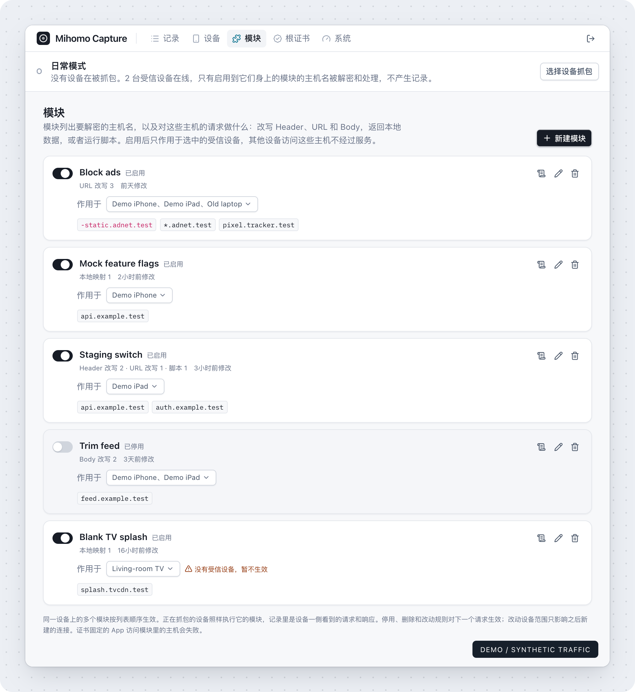
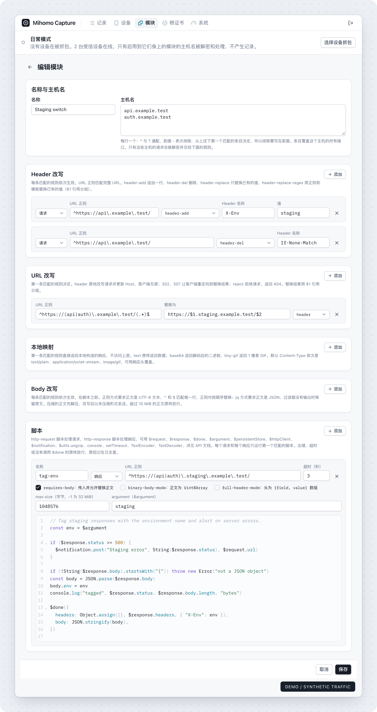
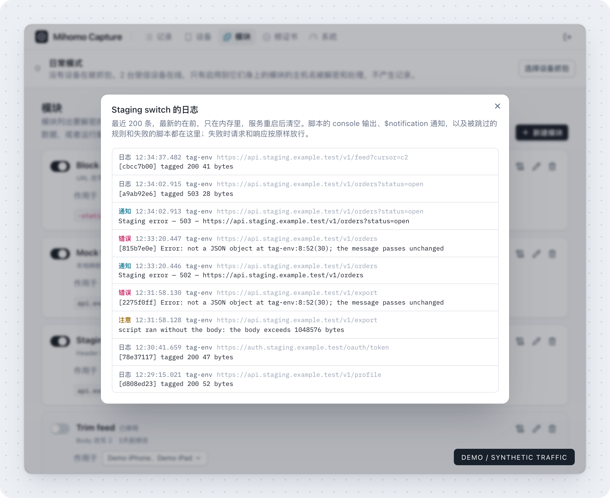
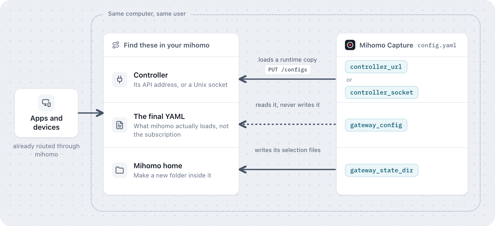
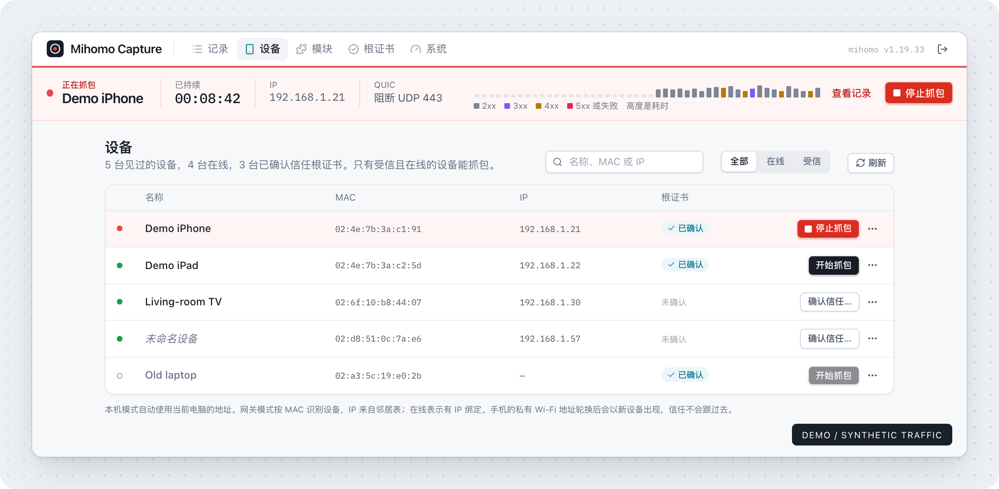

<p align="center">
  
</p>

<h1 align="center">Mihomo Capture</h1>

<p align="center"><strong>See what your apps send through <a href="https://github.com/MetaCubeX/mihomo">mihomo</a>, and change it per device, without changing where mihomo sends it.</strong></p>

<p align="center">English | <a href="README.zh-CN.md">简体中文</a> · <a href="LICENSE">MIT license</a> · <a href="https://github.com/gtoxlili/mihomo-capture/actions/workflows/ci.yml">CI</a></p>

[](docs/assets/dashboard-records.png)

*The real dashboard in gateway mode, with synthetic devices and traffic. Hosts and payloads are mock; no private capture is shown. Click images to zoom. The dashboard currently uses Chinese: 记录 Records, 设备 Devices, 模块 Modules, 根证书 Certificate, 系统 System.*

Mihomo Capture runs on the same computer as your [mihomo](https://github.com/MetaCubeX/mihomo). Pick a device, this computer or one on your LAN, and it records that device's HTTP, HTTPS, and WebSocket traffic. Turn on modules to rewrite, mock, or script requests for the devices and hostnames you choose. Either way, each connection still leaves through the policy your own mihomo rules picked.

- **Read what an app really sends.** Headers, bodies, status codes, timing, and WebSocket frames in both directions. Filter the records and copy a request as curl.
- **Rewrite and mock per device.** Change headers, URLs, and bodies, answer from local data, or run a JavaScript script, for the hosts you list on the devices you pick. Other devices see no change.
- **Keep your routing.** Your rules choose the policy first, using each device's real source address and port, so source-based rules and policy groups behave as before. There is no second proxy to chain in front of or behind mihomo.
- **Work with the mihomo you have.** It needs a stock core in `rule` mode and never writes your YAML. Its entries live only in mihomo's runtime configuration. Stopping the service empties its lanes, so mihomo hands it nothing, and a mihomo reload or restart removes the entries.

<details>
<summary>See WebSocket inspection</summary>

[](docs/assets/dashboard-websocket.png)

</details>

## What goes through the service



Mihomo evaluates your rules for every connection, as it always has. Only connections that mihomo hands to the capture lane or a daily lane reach the service. The service sends each one back through a loopback listener of mihomo's, which uses the policy already chosen, so your rules do not run a second time. [How that works](docs/mihomo.md#how-a-connection-keeps-its-policy). Capture and modules act on different traffic:

| | Capture | Modules |
| --- | --- | --- |
| Acts on | The one device you select | The trusted devices a module is enabled on |
| Requests | All its HTTP, HTTPS, and WebSocket traffic | Only requests to the hostnames the module lists |
| Result | Decrypted and recorded. The dashboard shows what the device sent and received | Decrypted, then rewritten, answered locally, or scripted. Nothing is recorded |
| When | While capture is on | Whenever the module is enabled, also with no capture running |

Everything else keeps mihomo's normal path, including other devices and any host no module lists. A captured device that also has modules gets both. Its records show the request it sent and the response it received, and name the modules that took effect.

## Modules

A module is a set of rules for a list of hostnames. Enable it on the trusted devices it should act on, and the service decrypts those hosts for those devices only, with or without a capture running.

[](docs/assets/dashboard-modules.png)

| To | Use |
| --- | --- |
| Block an ad or tracking host | URL rewrite, `reject` |
| Send an app to another server | URL rewrite, `header` |
| Answer a request without the real server | Map local, with text, base64, or a 1×1 GIF |
| Add, remove, or replace a header | Header rewrite |
| Patch a response body | Body rewrite, by regex or jq |
| Anything else | A script, in JavaScript, with `$request`, `$response`, `$done`, `$httpClient`, `$persistentStore`, `TextEncoder`, and `TextDecoder` |

Write modules on the dashboard's 模块 page, which has a form editor and a code editor for scripts, or through the [API](docs/api.md#modules). Modules carry no routing rules; routing stays mihomo's.

A rule or script that fails never blocks traffic. The message passes through unchanged and the reason goes to the module's log. Scripts run on the service host and can make network requests from it, and only the API token can write them. Apps that pin certificates fail on a module's hosts.

<details>
<summary>See the module editor and log</summary>

[](docs/assets/dashboard-module-editor.png)

[](docs/assets/dashboard-module-logs.png)

</details>

## Get connected

You need a stock [mihomo](https://github.com/MetaCubeX/mihomo) on the same computer, running in `rule` mode. macOS and Linux are supported; integration tests use mihomo v1.19.33. Windows is untested. Desktop clients must expose the core's controller and the final YAML they actually load.

### 1. Build or extract a release

For a source build, install Go 1.27.3+, Node.js 24+, and pnpm 12:

```sh
git clone https://github.com/gtoxlili/mihomo-capture.git
cd mihomo-capture
make install
make build
cp config.example.yaml config.yaml
```

`make build` builds the dashboard and embeds it in `bin/mihomo-capture`. If Make is unavailable, run `pnpm --dir web install --frozen-lockfile`, `pnpm --dir web build`, then `go build -trimpath -o bin/mihomo-capture ./cmd/mihomo-capture`.

When release archives are available on [Releases](https://github.com/gtoxlili/mihomo-capture/releases), extract one and copy the included configuration example. Verify it against the release's `SHA256SUMS` before running it.

### 2. Point it at your mihomo



Edit these fields in `config.yaml` to match your installation:

```yaml
mode: local
controller_url: http://127.0.0.1:9090
gateway_config: /absolute/path/to/mihomo/config.yaml
gateway_state_dir: /absolute/path/to/mihomo/mihomo-capture
# If mihomo has a secret, store it in a 0600 file:
# controller_token_file: ./controller-token
```

Use exactly one of `controller_url` or `controller_socket`. `gateway_config` must be the **final, loaded YAML**, usually a desktop client's generated file rather than the subscription. Put `gateway_state_dir` inside mihomo's home and run both programs as the same user. Relative service paths resolve beside `config.yaml`. Keep the controller local.

Some routing configurations, including `load-balance` and `include-all` groups, cannot preserve their meaning through capture. The next step's `-check` reports incompatibilities before capture starts. See [the full restrictions](docs/mihomo.md#compatibility-restrictions).

### 3. Trust the CA, then pick what to watch

```sh
bin/mihomo-capture -config config.yaml -init
bin/mihomo-capture -config config.yaml -check
scripts/run.sh config.yaml
```

Open <http://127.0.0.1:19090> and sign in with `cat data/api-token`. On every device you want to capture or run modules for, install and fully trust the dashboard's `Mihomo Capture CA`; the 根证书 page walks through it. Then confirm trust for that device on the 设备 page. From there you can start capture on it, enable modules on it, or both.

[](docs/assets/dashboard-devices.png)

Gateway mode, shown here, lists the devices on your LAN. In local mode the list holds this computer only.

The app must already use mihomo through its system proxy or TUN. Traffic that bypasses mihomo will not appear. Local mode discovers loopback and active interface addresses; add an extra TUN source reported by mihomo to `local_source_ips` if needed. The service does not install system certificates or change your system proxy.

## Local or LAN capture?

| | Local capture, the default | LAN gateway capture |
| --- | --- | --- |
| Configuration | `mode: local` | `mode: gateway`, plus `lan: 192.168.1.0/24` |
| Source | This computer's loopback and interface addresses | A selected IPv4 neighbor, identified by MAC |
| Traffic must use | This computer's mihomo | This computer as the device's mihomo gateway |
| CA trust | Install on this computer | Install on the selected device |

Gateway discovery uses macOS ARP or Linux `iproute2`. To let a phone download the CA, set `ca_listen` to your computer's LAN address and a free port. That listener serves only the public certificate; the dashboard and API can stay on loopback. Trust confirmation is an operator statement, not a remote trust-store check. Only one device records at a time. Modules work the same way in both modes and can be enabled on any number of trusted devices.

## Limits and cleanup

| Default | Limit |
| --- | --- |
| Retention | 24 hours / 5,000 records / 256 MiB total budget |
| HTTP bodies | 1 MiB each; binary as base64, with bounded gzip/deflate/Brotli decoded views |
| WebSocket frames | 128 per request, 16 KiB each |

Stored content is truncated at the limit while forwarding continues. Incomplete requests do not get replay commands. Stopping, switching devices, or clearing records invalidates old connections' write tickets. Capture stays off after a process restart.

<details>
<summary>Protocol limits</summary>

Pinned certificates may prevent interception. HTTP/3 uses UDP and cannot be decrypted here. Blocking UDP 443 for the selected device can encourage TCP fallback, and affects other UDP on that port too. Non-HTTP TCP and protocols outside HTTP interception pass through.

</details>

**Known issue with mihomo v1.19.33 and earlier.** Mihomo's HTTP outbound can drop bytes that arrive in the same read as the CONNECT response. During a capture, a protocol where the server speaks first, such as SSH or SMTP, can therefore lose its opening banner and hang. Only some connections are affected. Open a new connection, or stop the capture while you use such a protocol. The fix, [MetaCubeX/mihomo#3382](https://github.com/MetaCubeX/mihomo/pull/3382), is merged into mihomo's Alpha branch and will come with the next stable release after v1.19.33. [Details](docs/mihomo.md#known-issue-server-first-protocols).

Use `scripts/run.sh` so a child-process exit also clears capture selections. Stop normally with Ctrl-C. If both processes are killed, power is lost, or the controller is unavailable, cleanup cannot happen immediately. Recover with:

```sh
bin/mihomo-capture -config config.yaml -clear-gateway
# After stopping the service, remove capture nodes and the outbound listener:
bin/mihomo-capture -config config.yaml -remove-gateway
```

Restarting mihomo or reloading its own configuration also removes the entries. To uninstall, remove `Mihomo Capture CA` from system trust stores, then remove the generated data directory. It contains the CA private key and potentially sensitive captures.

## Development and documentation

Run `make check` after `make install`. Use `MIHOMO_TEST_BINARY=/absolute/path/to/mihomo make test` for isolated stock-core tests. `pnpm --dir web dev` forwards API calls to `127.0.0.1:19090`, configurable with `MIHOMO_CAPTURE_API`. A [read-only mock preview](docs/demo/README.md) reproduces the screenshots without a running mihomo, and the same page says how to redraw the diagrams.

[HTTP API](docs/api.md) · [Integration](docs/mihomo.md) · [Troubleshooting](SUPPORT.md) · [Contributing](CONTRIBUTING.md) · [Changelog](CHANGELOG.md) · [Releases](docs/releasing.md) · [Security](SECURITY.md) · [Code of conduct](CODE_OF_CONDUCT.md)

Bug reports and feature requests belong in [Issues](https://github.com/gtoxlili/mihomo-capture/issues). English and Chinese are welcome; sensitive reports follow the security policy.

[MIT](LICENSE). Built on [MetaCubeX/mihomo](https://github.com/MetaCubeX/mihomo), which is a separate dependency and is not bundled. Release archives include dependency license notices.
