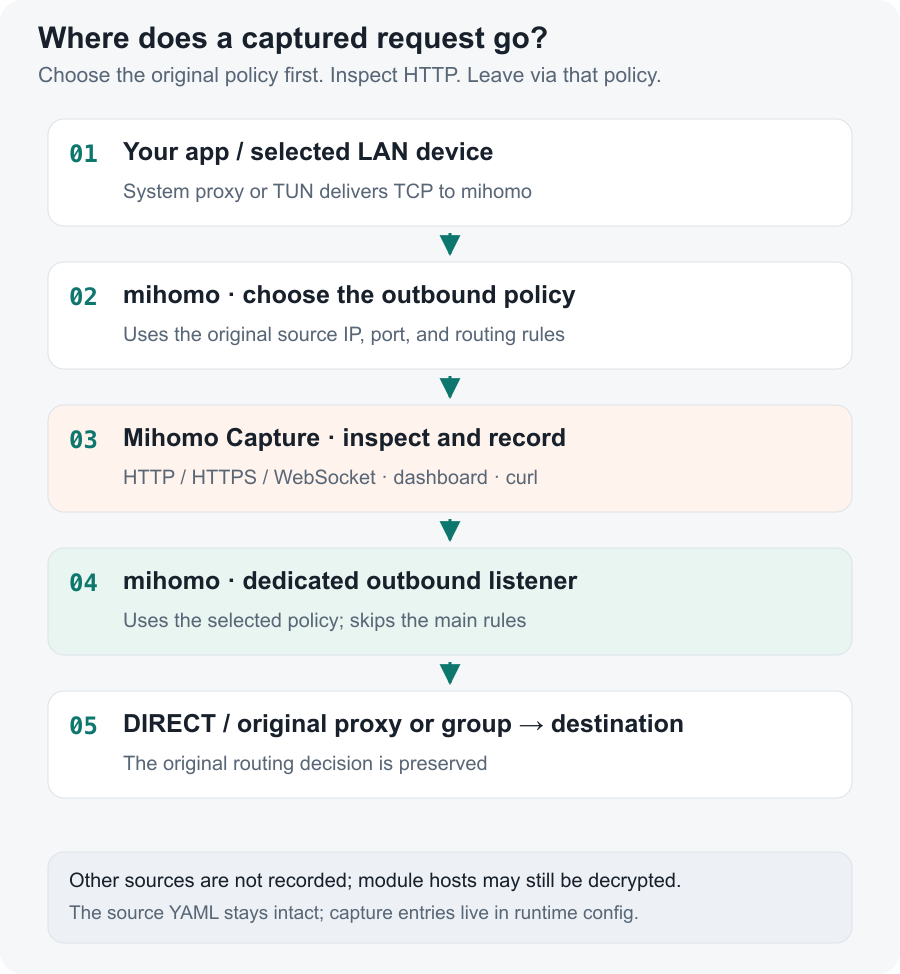
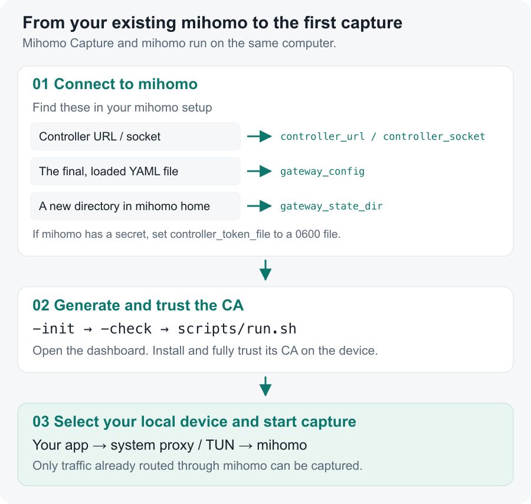

# Mihomo Capture

English | [简体中文](README.zh-CN.md) · [MIT license](LICENSE) · [CI checks](https://github.com/gtoxlili/mihomo-capture/actions/workflows/ci.yml)

Inspect HTTP, HTTPS, and WebSocket traffic through the mihomo instance on your computer. Start with local capture, or select a LAN device when your computer is its gateway. Requests keep mihomo's original outbound policy.

[](docs/assets/dashboard-http.png)

*The real dashboard with synthetic traffic. All hosts and payloads are mock data; no private capture is shown. Click images to zoom. The dashboard currently uses Chinese.*

- Inspect request and response headers, bodies, status codes, and timing.
- Follow WebSocket frames in both directions, including fragmentation and compression flags.
- Filter records and export complete requests as curl commands.

<details>
<summary>See WebSocket inspection</summary>

[](docs/assets/dashboard-websocket.png)

</details>

## How it works

Mihomo picks a policy while it still has the original source IP and port. Capture inspects the connection, then returns it to a dedicated mihomo listener that uses the selected policy directly. The return connection never needs to choose a policy from the main rules again.



The service reads your final mihomo YAML and adds capture entries to its **runtime configuration**. It does not edit the original file. [Integration details and compatibility](docs/mihomo.md) explain the rule copies, reloads, and cleanup.

## Get connected

You need stock mihomo on the same computer, running in `rule` mode. macOS and Linux are supported; integration tests use mihomo v1.19.33. Windows is untested. Desktop clients must expose the core's controller and the final YAML they actually load.



### 1. Build or extract a release

For a source build, install Go 1.27.3+, Node.js 24+, and pnpm 12:

```sh
git clone https://github.com/gtoxlili/mihomo-capture.git
cd mihomo-capture
make install
make build
cp config.example.yaml config.yaml
```

`make build` builds the dashboard and embeds it in `bin/mihomo-capture`. If Make is unavailable, run `pnpm --dir web install --frozen-lockfile`, `pnpm --dir web build`, then `go build -trimpath -o bin/mihomo-capture ./cmd/mihomo-capture`.

When release archives are available on [Releases](https://github.com/gtoxlili/mihomo-capture/releases), extract one and copy the included configuration example. Verify it against the release's `SHA256SUMS` before running it.

### 2. Point it at your mihomo

Edit these fields in `config.yaml` to match your installation:

```yaml
mode: local
controller_url: http://127.0.0.1:9090
gateway_config: /absolute/path/to/mihomo/config.yaml
gateway_state_dir: /absolute/path/to/mihomo/mihomo-capture
# If mihomo has a secret, store it in a 0600 file:
# controller_token_file: ./controller-token
```

Use exactly one of `controller_url` or `controller_socket`. `gateway_config` must be the **final, loaded YAML**, usually a desktop client's generated file rather than the subscription. Put `gateway_state_dir` inside mihomo's home and run both programs as the same user. Relative service paths resolve beside `config.yaml`. Keep the controller local.

Some routing configurations, including `load-balance` and `include-all` groups, cannot preserve their meaning through capture. The next step's `-check` reports incompatibilities before capture starts. See [the full restrictions](docs/mihomo.md#compatibility-restrictions).

### 3. Trust the CA and start capture

```sh
bin/mihomo-capture -config config.yaml -init
bin/mihomo-capture -config config.yaml -check
scripts/run.sh config.yaml
```

Open <http://127.0.0.1:19090> and sign in with `cat data/api-token`. Install and fully trust the dashboard's `Mihomo Capture CA` on the device. In the dashboard, confirm trust for **本机**, then start capture.

The app must already use mihomo through its system proxy or TUN. Traffic that bypasses mihomo will not appear. Local mode discovers loopback and active interface addresses; add an extra TUN source reported by mihomo to `local_source_ips` if needed. The service does not install system certificates or change your system proxy.

## Local or LAN capture?

| | Local capture, the default | LAN gateway capture |
| --- | --- | --- |
| Configuration | `mode: local` | `mode: gateway`, plus `lan: 192.168.1.0/24` |
| Source | This computer's loopback and interface addresses | A selected IPv4 neighbor, identified by MAC |
| Traffic must use | This computer's mihomo | This computer as the device's mihomo gateway |
| CA trust | Install on this computer | Install on the selected device |

Gateway discovery uses macOS ARP or Linux `iproute2`. To let a phone download the CA, set `ca_listen` to your computer's LAN address and a free port. That listener serves only the public certificate; the dashboard and API can stay on loopback. Trust confirmation is an operator statement, not a remote trust-store check. Only one device records at a time.

## Modules

A module processes the requests of chosen devices without recording them. It lists the hostnames to decrypt and what to do with their requests: rewrite headers, URLs and bodies (by regex or jq), answer from local data, or run `http-request` and `http-response` scripts. Write modules on the dashboard's 模块 page or through the [API](docs/api.md#modules), then enable each one for the trusted devices it should act on. Other devices, and other hosts, never pass through the service.

A captured device keeps running its modules, and its records show what the device sent and received. A rule or script that fails passes the message through unchanged and notes why in the module's log. Scripts run on the service host and can make network requests from it; only the API token can write them. Apps that pin certificates fail on a module's hosts.

## Limits and cleanup

| Default | Limit |
| --- | --- |
| Retention | 24 hours / 5,000 records / 256 MiB total budget |
| HTTP bodies | 1 MiB each; binary as base64, with bounded gzip/deflate/Brotli decoded views |
| WebSocket frames | 128 per request, 16 KiB each |

Stored content is truncated at the limit while forwarding continues. Incomplete requests do not get replay commands. Stopping, switching devices, or clearing records invalidates old connections' write tickets. Capture stays off after a process restart.

<details>
<summary>Protocol limits</summary>

Pinned certificates may prevent interception. HTTP/3 uses UDP and cannot be decrypted here. Blocking UDP 443 for the selected device can encourage TCP fallback, and affects other UDP on that port too. Non-HTTP TCP and protocols outside HTTP interception pass through.

</details>

Use `scripts/run.sh` so a child-process exit also clears capture selections. Stop normally with Ctrl-C. If both processes are killed, power is lost, or the controller is unavailable, cleanup cannot happen immediately. Recover with:

```sh
bin/mihomo-capture -config config.yaml -clear-gateway
# After stopping the service, remove capture nodes and the outbound listener:
bin/mihomo-capture -config config.yaml -remove-gateway
```

Restarting mihomo or reloading its own configuration also removes the entries. To uninstall, remove `Mihomo Capture CA` from system trust stores, then remove the generated data directory. It contains the CA private key and potentially sensitive captures.

## Development and documentation

Run `make check` after `make install`. Use `MIHOMO_TEST_BINARY=/absolute/path/to/mihomo make test` for isolated stock-core tests. `pnpm --dir web dev` forwards API calls to `127.0.0.1:19090`, configurable with `MIHOMO_CAPTURE_API`. A [read-only mock preview](docs/demo/README.md) reproduces the screenshots without a running mihomo.

[HTTP API](docs/api.md) · [Integration](docs/mihomo.md) · [Troubleshooting](SUPPORT.md) · [Contributing](CONTRIBUTING.md) · [Changelog](CHANGELOG.md) · [Releases](docs/releasing.md) · [Security](SECURITY.md) · [Code of conduct](CODE_OF_CONDUCT.md)

Bug reports and feature requests belong in [Issues](https://github.com/gtoxlili/mihomo-capture/issues). English and Chinese are welcome; sensitive reports follow the security policy.

[MIT](LICENSE). Mihomo is a separate dependency and is not bundled. Release archives include dependency license notices.
