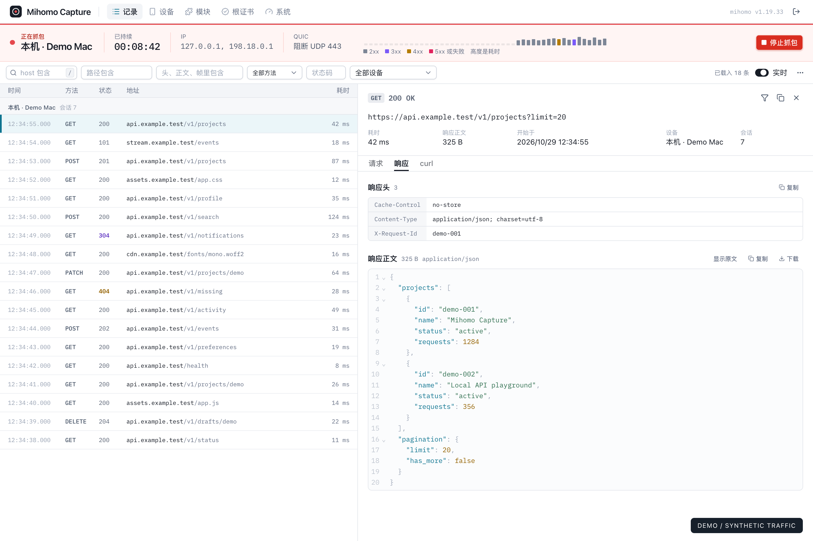
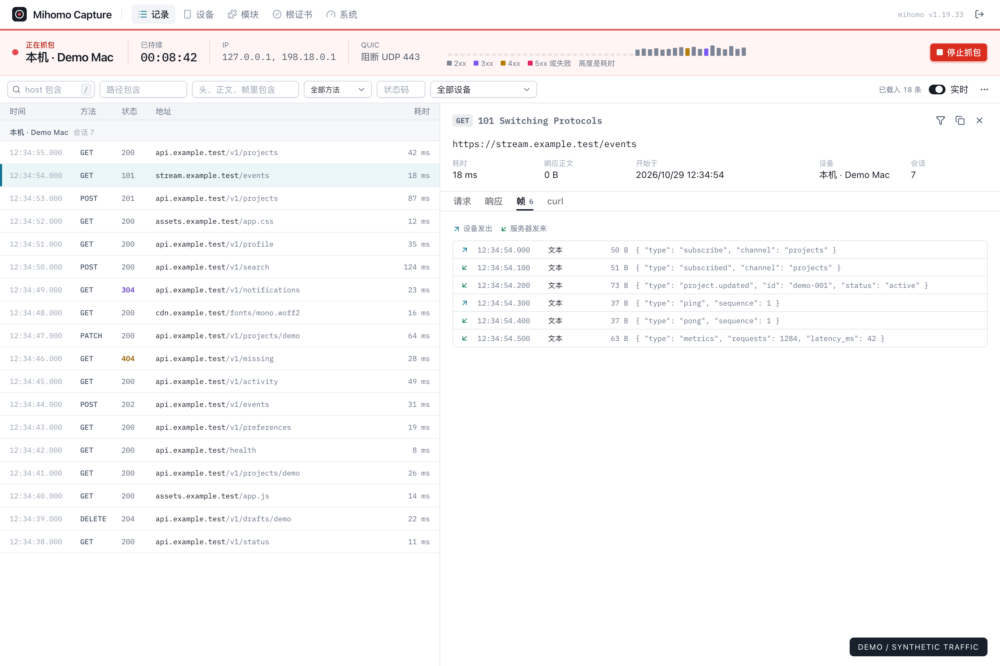
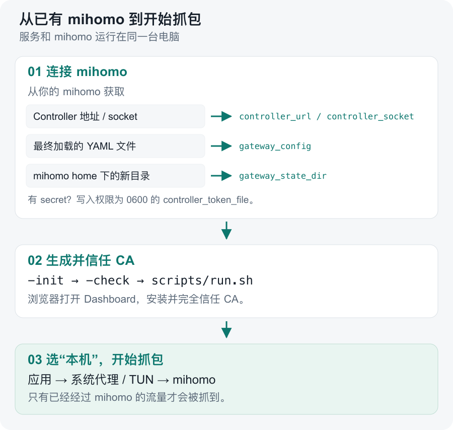

# Mihomo Capture

[English](README.md) | 简体中文 · [MIT 许可证](LICENSE) · [CI 检查](https://github.com/gtoxlili/mihomo-capture/actions/workflows/ci.yml)

通过电脑上已有的 mihomo 查看 HTTP、HTTPS 请求和 WebSocket 帧。默认抓本机；电脑用作网关时，也可以选择一台局域网设备。抓包期间仍沿用 mihomo 原来的分流策略。

[](docs/assets/dashboard-http.png)

*真实界面，演示数据。域名和内容均为 mock，不包含私人抓包记录。点击图片可放大查看。当前 Dashboard 使用中文。*

- 查看请求和响应的头、正文、状态码与耗时。
- 检查 WebSocket 双向帧，保留分片和压缩标记。
- 筛选记录，把完整请求复制为 curl 命令。

<details>
<summary>查看 WebSocket 抓包截图</summary>

[](docs/assets/dashboard-websocket.png)

</details>

## 原理先看这张图

mihomo 在原设备的来源 IP 和端口还完整时选策略，再把连接交给抓包服务。服务解密、记录后，经 mihomo 的专用出口回到已经选好的策略，不让回源连接重新匹配主规则。


服务读取最终 YAML，把附加节点与规则装进 mihomo 的**运行配置**，不改原始文件。规则副本、重载和清理的细节见[接入原理与兼容限制](docs/mihomo.zh-CN.md)。

## 怎么接入

需要同机运行的原版 mihomo，并保持 `rule` 模式。目前支持 macOS 和 Linux，集成测试使用 mihomo v1.19.33；Windows 尚未验证。使用桌面客户端时，需要拿到 core 的 controller 和它实际加载的最终 YAML。



### 1. 构建源码或解压发布包

源码构建需要 Go 1.27.3+、Node.js 24+ 和 pnpm 12：

```sh
git clone https://github.com/gtoxlili/mihomo-capture.git
cd mihomo-capture
make install
make build
cp config.example.yaml config.yaml
```

`make build` 先构建网页，再嵌入 `bin/mihomo-capture`。没有 Make 时，依次运行 `pnpm --dir web install --frozen-lockfile`、`pnpm --dir web build` 和 `go build -trimpath -o bin/mihomo-capture ./cmd/mihomo-capture`。

[Releases](https://github.com/gtoxlili/mihomo-capture/releases) 有发布包后，也可以直接解压并复制其中的示例配置。运行前请核对发布页的 `SHA256SUMS`。

### 2. 填入你的 mihomo 配置

修改 `config.yaml`，把路径换成实际安装位置：

```yaml
mode: local
controller_url: http://127.0.0.1:9090
gateway_config: /absolute/path/to/mihomo/config.yaml
gateway_state_dir: /absolute/path/to/mihomo/mihomo-capture
# mihomo 有 secret 时，把值写进权限为 0600 的文件：
# controller_token_file: ./controller-token
```

`controller_url` 和 `controller_socket` 二选一。`gateway_config` 必须是**最终加载的 YAML**，通常是桌面客户端生成的文件，而非订阅文件。`gateway_state_dir` 放在 mihomo home 下，两者用同一用户运行。服务的相对路径以 `config.yaml` 所在目录为准。controller 保留在本机。

`load-balance`、`include-all` 等配置无法保证抓包前后分流含义一致，下一步的 `-check` 会在开始前报出不兼容原因。[完整限制](docs/mihomo.zh-CN.md#配置限制)见接入文档。

### 3. 信任证书，开始抓包

```sh
bin/mihomo-capture -config config.yaml -init
bin/mihomo-capture -config config.yaml -check
scripts/run.sh config.yaml
```

打开 <http://127.0.0.1:19090>，用 `cat data/api-token` 读取登录令牌。在设备上安装并完全信任页面提供的 `Mihomo Capture CA`，回到 Dashboard 为“本机”确认信任，再开始抓包。

应用必须已经通过系统代理或 TUN 使用 mihomo，绕过它的流量不会出现。本机模式自动发现回环和活动网卡地址；如果 mihomo 报告了额外的 TUN 来源地址，填入 `local_source_ips`。服务不会替你安装系统证书或修改系统代理。

## 抓本机还是局域网设备？

| | 本机抓包，默认模式 | 局域网网关抓包 |
| --- | --- | --- |
| 配置 | `mode: local` | `mode: gateway`，另填 `lan: 192.168.1.0/24` |
| 设备来源 | 本机的回环和网卡地址 | 选中的 IPv4 邻居，按 MAC 识别 |
| 流量必须经过 | 本机 mihomo | 作为该设备网关的本机 mihomo |
| CA 安装位置 | 当前电脑 | 被选中的设备 |

网关模式使用 macOS ARP 或 Linux `iproute2` 发现设备。手机需要下载证书时，把 `ca_listen` 设为电脑的 LAN 地址和空闲端口；它只提供公开证书，Dashboard 与 API 可以继续留在回环地址。信任确认只是操作者的记录，服务无法远程检查系统信任库。同一时刻只录制一台设备。

## 模块

模块处理选定设备的请求，但不记录。它列出要解密的主机名，以及对这些主机的请求做什么：改写 Header、URL 和正文（正则或 jq），用本地数据直接应答，或者运行 `http-request` 和 `http-response` 脚本。在 Dashboard 的模块页或通过 [API](docs/api.zh-CN.md#模块) 编写模块，再为每个模块启用它要作用的受信设备。其他设备和其他主机的流量都不经过服务。

被抓包的设备照常执行它的模块，记录里是设备一侧发出和收到的内容。规则或脚本失败时消息原样放行，原因记在模块日志里。脚本运行在服务所在的电脑上，可以从这台电脑发起网络请求；只有持有 API token 才能编写脚本。证书固定的应用访问模块里的主机会失败。

## 限制与清理

| 默认设置 | 上限 |
| --- | --- |
| 记录保留 | 24 小时 / 5000 条 / 总预算 256 MiB |
| HTTP 正文 | 每个 1 MiB；二进制用 base64，另有有界 gzip/deflate/Brotli 解压视图 |
| WebSocket 帧 | 每条请求 128 帧，每帧 16 KiB |

达到上限会截断保存内容，转发继续。不完整的请求不提供重放命令。停止、换设备和清空记录都会使旧连接的写入凭证失效；服务重启后不会自动恢复抓包。

<details>
<summary>协议边界</summary>

证书固定的应用可能拒绝拦截。HTTP/3 使用 UDP，无法在这里解密。阻断所选设备的 UDP 443 可促使支持回落的应用走 TCP，也会影响同端口的其他 UDP。非 HTTP TCP 和不属于 HTTP 拦截范围的协议透传。

</details>

用 `scripts/run.sh` 启动，子进程退出时也会清空抓包选择；正常停止按 Ctrl-C。如果两个进程都被强杀、机器断电或 controller 失联，清理无法立即完成，可运行：

```sh
bin/mihomo-capture -config config.yaml -clear-gateway
# 停止服务后，移除附加节点与出口监听器：
bin/mihomo-capture -config config.yaml -remove-gateway
```

mihomo 自己重启或重载原配置后也会移除这些附加项。卸载时，从系统信任库删除 `Mihomo Capture CA`，再删除生成的 data 目录。这里保存了 CA 私钥和可能敏感的抓包内容。

## 开发与文档

`make install` 后运行 `make check`。独立 core 测试使用 `MIHOMO_TEST_BINARY=/absolute/path/to/mihomo make test`。`pnpm --dir web dev` 默认把 API 转发到 `127.0.0.1:19090`，可以用 `MIHOMO_CAPTURE_API` 修改。[只读 mock 预览](docs/demo/README.md)可复现截图，不需要运行 mihomo。

[HTTP API](docs/api.zh-CN.md) · [接入原理](docs/mihomo.zh-CN.md) · [排障](SUPPORT.md) · [贡献指南](CONTRIBUTING.md) · [更新记录](CHANGELOG.md) · [发布](docs/releasing.md) · [安全反馈](SECURITY.md) · [行为准则](CODE_OF_CONDUCT.md)

Bug 和功能建议请提 [Issue](https://github.com/gtoxlili/mihomo-capture/issues)，英文或中文都可以；敏感问题请走安全反馈流程。

[MIT 许可证](LICENSE)。项目不捆绑 mihomo，发布包附带依赖的许可证说明。
