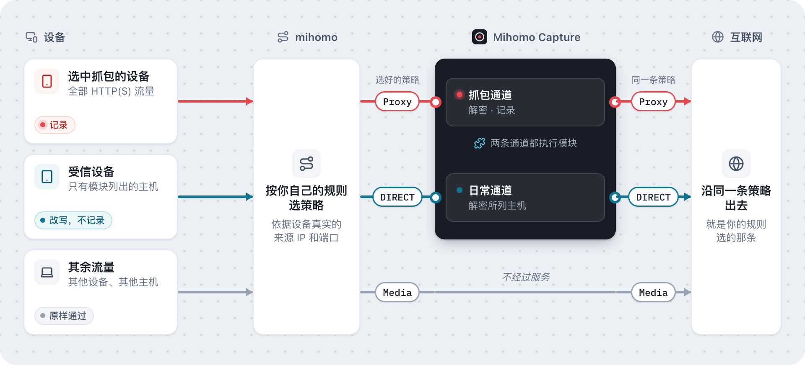
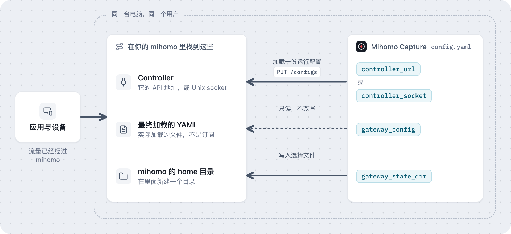

<p align="center">
  
</p>

<h1 align="center">Mihomo Capture</h1>

<p align="center"><strong>看清应用经 <a href="https://github.com/MetaCubeX/mihomo">mihomo</a> 发出的每个请求，还能按设备改写，mihomo 原本的分流结果不变。</strong></p>

<p align="center"><a href="README.md">English</a> | 简体中文 · <a href="LICENSE">MIT 许可证</a> · <a href="https://github.com/gtoxlili/mihomo-capture/actions/workflows/ci.yml">CI</a></p>

[](docs/assets/dashboard-records.png)

*真实界面，网关模式，设备和流量均为演示数据。域名和内容都是 mock，不包含私人抓包记录。点击图片可放大查看。当前 Dashboard 使用中文。*

Mihomo Capture 和你的 [mihomo](https://github.com/MetaCubeX/mihomo) 跑在同一台电脑上。选一台设备，本机或局域网里的任意一台，它就记录这台设备的 HTTP、HTTPS 和 WebSocket 流量。再用模块，对你指定的设备和主机名改写请求、mock 响应或运行脚本。两种用法下，连接最终都沿你自己的 mihomo 规则选好的策略出去。

- **看清 App 到底发了什么。** 请求头和正文，状态码和耗时，以及双向的 WebSocket 帧。可以筛选记录，把一条请求复制成 curl 命令。
- **按设备改写和 mock。** 改写 Header、URL 和正文，用本地数据直接应答，或者运行 JavaScript 脚本。只作用于你列出的主机和你选中的设备，其他设备不受影响。
- **分流结果不变。** 先由你的规则选策略，用的是设备真实的来源地址和端口，所以按来源匹配的规则和策略组照常生效。不用在 mihomo 前后再串一层代理。
- **接在现有的 mihomo 上。** 需要原版 core，保持 `rule` 模式，不会改写你的 YAML。附加项只存在于 mihomo 的运行配置里。服务停止时会清空通道，mihomo 不再把流量交给它；mihomo 重载或重启后，这些附加项也随之消失。

<details>
<summary>查看 WebSocket 抓包截图</summary>

[](docs/assets/dashboard-websocket.png)

</details>

## 哪些流量会经过服务



mihomo 照常为每条连接匹配你的规则。只有 mihomo 把连接交给抓包通道或日常通道，连接才会到达服务。服务再把它送回 mihomo 的回环出口，出口直接使用已经选好的策略，不会再匹配一遍规则。[具体过程](docs/mihomo.zh-CN.md#一条连接怎样保留原策略)。抓包和模块作用在不同的流量上：

| | 抓包 | 模块 |
| --- | --- | --- |
| 作用对象 | 你选中的那一台设备 | 启用了该模块的受信设备 |
| 作用的请求 | 它的全部 HTTP、HTTPS 和 WebSocket 流量 | 只有访问模块所列主机名的请求 |
| 结果 | 解密并记录，Dashboard 里是设备发出和收到的内容 | 解密后改写、本地应答或交给脚本，不记录 |
| 何时生效 | 抓包进行期间 | 模块启用期间，不抓包时同样生效 |

其余流量照走 mihomo 原来的路径：其他设备，以及没有模块列出的主机。被抓包的设备如果也启用了模块，两者同时作用：记录里是设备发出的请求和收到的响应，并标出生效的模块。

## 模块

模块是一组针对若干主机名的规则。把它启用到需要的受信设备上，服务就只为这些设备解密这些主机，不抓包时也一样。

[](docs/assets/dashboard-modules.png)

| 想做的事 | 用什么 |
| --- | --- |
| 屏蔽广告或统计域名 | URL 改写，`reject` |
| 让 App 访问另一台服务器 | URL 改写，`header` |
| 不访问真实服务器，直接给出响应 | 本地映射：文本、base64 或 1×1 GIF |
| 增加、删除或替换请求头和响应头 | Header 改写 |
| 修改响应正文 | Body 改写，正则或 jq |
| 其他 | 脚本：JavaScript，可用 `$request`、`$response`、`$done`、`$httpClient`、`$persistentStore`、`TextEncoder` 和 `TextDecoder` |

在 Dashboard 的模块页编写（有表单编辑器，脚本有代码编辑器），或通过 [API](docs/api.zh-CN.md#模块)。模块不带分流规则，分流仍由 mihomo 决定。

规则或脚本失败不会阻断流量：消息原样放行，原因记在模块日志里。脚本运行在服务所在的电脑上，可以从这台电脑发起网络请求；只有持有 API token 才能编写脚本。证书固定的应用访问模块里的主机会失败。

<details>
<summary>查看模块编辑器和日志</summary>

[](docs/assets/dashboard-module-editor.png)

[](docs/assets/dashboard-module-logs.png)

</details>

## 怎么接入

需要同机运行的原版 [mihomo](https://github.com/MetaCubeX/mihomo)，并保持 `rule` 模式。目前支持 macOS 和 Linux，集成测试使用 mihomo v1.19.33；Windows 尚未验证。使用桌面客户端时，需要拿到 core 的 controller 和它实际加载的最终 YAML。

### 1. 构建源码或解压发布包

源码构建需要 Go 1.27.3+、Node.js 24+ 和 pnpm 12：

```sh
git clone https://github.com/gtoxlili/mihomo-capture.git
cd mihomo-capture
make install
make build
cp config.example.yaml config.yaml
```

`make build` 先构建网页，再嵌入 `bin/mihomo-capture`。没有 Make 时，依次运行 `pnpm --dir web install --frozen-lockfile`、`pnpm --dir web build` 和 `go build -trimpath -o bin/mihomo-capture ./cmd/mihomo-capture`。

[Releases](https://github.com/gtoxlili/mihomo-capture/releases) 有发布包后，也可以直接解压并复制其中的示例配置。运行前请核对发布页的 `SHA256SUMS`。

### 2. 填入你的 mihomo 配置



修改 `config.yaml`，把路径换成实际安装位置：

```yaml
mode: local
controller_url: http://127.0.0.1:9090
gateway_config: /absolute/path/to/mihomo/config.yaml
gateway_state_dir: /absolute/path/to/mihomo/mihomo-capture
# mihomo 有 secret 时，把值写进权限为 0600 的文件：
# controller_token_file: ./controller-token
```

`controller_url` 和 `controller_socket` 二选一。`gateway_config` 必须是**最终加载的 YAML**，通常是桌面客户端生成的文件，而非订阅文件。`gateway_state_dir` 放在 mihomo home 下，两者用同一用户运行。服务的相对路径以 `config.yaml` 所在目录为准。controller 保留在本机。

`load-balance`、`include-all` 等配置无法保证抓包前后分流含义一致，下一步的 `-check` 会在开始前报出不兼容原因。[完整限制](docs/mihomo.zh-CN.md#配置限制)见接入文档。

### 3. 信任证书，选好要看的设备

```sh
bin/mihomo-capture -config config.yaml -init
bin/mihomo-capture -config config.yaml -check
scripts/run.sh config.yaml
```

打开 <http://127.0.0.1:19090>，用 `cat data/api-token` 读取登录令牌。在每台要抓包或要运行模块的设备上，安装并完全信任页面提供的 `Mihomo Capture CA`，根证书页有安装步骤。然后在设备页为这台设备确认信任。之后可以对它开始抓包，也可以给它启用模块，或者两者都用。

[](docs/assets/dashboard-devices.png)

上图是网关模式，列出局域网里的设备；本机模式下这里只有这台电脑。

应用必须已经通过系统代理或 TUN 使用 mihomo，绕过它的流量不会出现。本机模式自动发现回环和活动网卡地址；如果 mihomo 报告了额外的 TUN 来源地址，填入 `local_source_ips`。服务不会替你安装系统证书或修改系统代理。

## 抓本机还是局域网设备？

| | 本机抓包，默认模式 | 局域网网关抓包 |
| --- | --- | --- |
| 配置 | `mode: local` | `mode: gateway`，另填 `lan: 192.168.1.0/24` |
| 设备来源 | 本机的回环和网卡地址 | 选中的 IPv4 邻居，按 MAC 识别 |
| 流量必须经过 | 本机 mihomo | 作为该设备网关的本机 mihomo |
| CA 安装位置 | 当前电脑 | 被选中的设备 |

网关模式使用 macOS ARP 或 Linux `iproute2` 发现设备。手机需要下载证书时，把 `ca_listen` 设为电脑的 LAN 地址和空闲端口；它只提供公开证书，Dashboard 与 API 可以继续留在回环地址。信任确认只是操作者的记录，服务无法远程检查系统信任库。同一时刻只录制一台设备。模块在两种模式下用法相同，可以启用到任意多台受信设备上。

## 限制与清理

| 默认设置 | 上限 |
| --- | --- |
| 记录保留 | 24 小时 / 5000 条 / 总预算 256 MiB |
| HTTP 正文 | 每个 1 MiB；二进制用 base64，另有有界 gzip/deflate/Brotli 解压视图 |
| WebSocket 帧 | 每条请求 128 帧，每帧 16 KiB |

达到上限会截断保存内容，转发继续。不完整的请求不提供重放命令。停止、换设备和清空记录都会使旧连接的写入凭证失效；服务重启后不会自动恢复抓包。

<details>
<summary>协议边界</summary>

证书固定的应用可能拒绝拦截。HTTP/3 使用 UDP，无法在这里解密。阻断所选设备的 UDP 443 可促使支持回落的应用走 TCP，也会影响同端口的其他 UDP。非 HTTP TCP 和不属于 HTTP 拦截范围的协议透传。

</details>

**mihomo v1.19.33 及更早版本的已知问题。** mihomo 的 HTTP 出站读取 CONNECT 响应时，可能丢掉和它同一批到达的数据。抓包期间，SSH、SMTP 这类由服务器先发数据的协议，可能收不到开头的 banner，连接随之卡住。只有部分连接会遇到。重新建立连接，或者在使用这类协议时先停止抓包。修复 [MetaCubeX/mihomo#3382](https://github.com/MetaCubeX/mihomo/pull/3382) 已合并到 mihomo 的 Alpha 分支，会随 v1.19.33 之后的下一个正式版发布。[详情](docs/mihomo.zh-CN.md#已知问题服务器先发数据的协议)。

用 `scripts/run.sh` 启动，子进程退出时也会清空抓包选择；正常停止按 Ctrl-C。如果两个进程都被强杀、机器断电或 controller 失联，清理无法立即完成，可运行：

```sh
bin/mihomo-capture -config config.yaml -clear-gateway
# 停止服务后，移除附加节点与出口监听器：
bin/mihomo-capture -config config.yaml -remove-gateway
```

mihomo 自己重启或重载原配置后也会移除这些附加项。卸载时，从系统信任库删除 `Mihomo Capture CA`，再删除生成的 data 目录。这里保存了 CA 私钥和可能敏感的抓包内容。

## 开发与文档

`make install` 后运行 `make check`。独立 core 测试使用 `MIHOMO_TEST_BINARY=/absolute/path/to/mihomo make test`。`pnpm --dir web dev` 默认把 API 转发到 `127.0.0.1:19090`，可以用 `MIHOMO_CAPTURE_API` 修改。[只读 mock 预览](docs/demo/README.md)可复现截图，不需要运行 mihomo，那里也说明了怎样重画示意图。

[HTTP API](docs/api.zh-CN.md) · [接入原理](docs/mihomo.zh-CN.md) · [排障](SUPPORT.md) · [贡献指南](CONTRIBUTING.md) · [更新记录](CHANGELOG.md) · [发布](docs/releasing.md) · [安全反馈](SECURITY.md) · [行为准则](CODE_OF_CONDUCT.md)

Bug 和功能建议请提 [Issue](https://github.com/gtoxlili/mihomo-capture/issues)，英文或中文都可以；敏感问题请走安全反馈流程。

[MIT 许可证](LICENSE)。基于 [MetaCubeX/mihomo](https://github.com/MetaCubeX/mihomo) 构建，它是独立的依赖，项目不捆绑它。发布包附带依赖的许可证说明。
