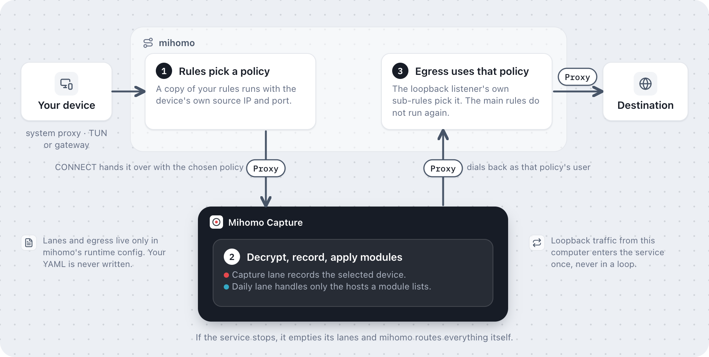

# mihomo integration

[简体中文](mihomo.zh-CN.md)

For initial setup, follow the [illustrated connection guide](../README.md#get-connected). This page explains how Mihomo Capture sits inside [mihomo](https://github.com/MetaCubeX/mihomo)'s own routing, and why every connection keeps the policy your rules chose.

Mihomo Capture runs on the same computer as mihomo. It reads the actual loaded YAML and uses the controller's `PUT /configs` endpoint to load a copy with capture entries added. The source file is never written. File rule providers live in `gateway_state_dir`, which must be readable by mihomo and should be inside its home directory. The entries are proxies, rule providers, and sub-rules prefixed with `mihomo-capture-`, plus an HTTP outbound listener bound to loopback.

## How a connection keeps its policy

1. **Rules pick a policy.** Each lane copies the original rules and sub-rules. Mihomo evaluates the copy while the connection's source metadata is still the device's own, so source-based rules and groups choose exactly as they would without the service. In the copy, each policy is an HTTP proxy node that points at the service, and mihomo sends the chosen policy's ID in the proxy CONNECT headers.
2. **The service decrypts.** It checks the proxy credentials, reads the lane from the headers, decrypts the hosts the lane covers, records on the capture lane, and applies the modules of the lane's set. [Lanes](#lanes) says which traffic each one carries.
3. **Egress uses that policy.** The service re-enters mihomo through the outbound listener as the user that stands for the chosen policy. The listener's own sub-rules select that policy without evaluating the main rules again, so the connection cannot loop back into the service. This also lets loopback traffic be captured without repeatedly entering the service.

## Lanes

A lane is one way into the service, and its name tells the service which traffic it carries.

| Lane | Receives | Decrypts | Records |
| --- | --- | --- | --- |
| `capture` | TCP from the selected device | Its HTTP, HTTPS, and WebSocket | Yes |
| `daily-N` | The trusted devices that share one set of enabled modules | Only the hostnames of those modules | No |

The selected device takes the capture lane, with the modules enabled on it, and no daily lane. Selection changes update only the provider files. The first nonempty selection loads the extra configuration with two daily lanes; when more module sets are in use than it holds, the service reloads it with twice as many. A set no device uses any more keeps its lane for 30 seconds before another set takes it, so a connection mihomo routed just before a change still gets the modules it was routed for. The service checks every five seconds and reinstalls the configuration if mihomo has reloaded its own. After editing mihomo's source file, reload it normally so the running configuration and file agree.

## Compatibility restrictions

Mihomo must remain in `rule` mode. Do not switch to `global` or `direct` with capture entries installed, and do not select internal `mihomo-capture-` nodes in a desktop client. A mode switch can bypass outbound sub-rules and cause routing loops. Stop the service and run `-remove-gateway` before changing modes.

The service rejects configurations it cannot preserve, including `PASS`, `PASS-RULE`, source-dependent `load-balance` groups, group types other than select/fallback/url-test, and `include-all` or `include-all-proxies`. Explicit group members avoid accidentally including capture nodes as ordinary outbounds. Existing names with the reserved prefix, missing rules, unknown policies, and conflicting outbound ports are also rejected. Use `-check` first.

The required inputs are the core's controller and final configuration. The service does not read a desktop client's database or infer its subscription conversion and merge behavior. Clients that automatically replace the running core configuration may conflict with capture reloads. Disable that behavior or use a standalone core.

## Known issue: server-first protocols

A lane's proxy nodes are HTTP outbounds in mihomo, so a connection reaches the service as a CONNECT request. Up to v1.19.33, mihomo's HTTP outbound reads the CONNECT response through a buffered reader and then drops the reader. When the service writes the target's first bytes right behind its `200` response, they can arrive in the same read and be lost. A protocol where the server speaks first, such as SSH or SMTP, then misses its opening banner and the connection hangs. The loss depends on timing, so only some connections are affected.

Any lane can be affected. The capture lane carries every TCP connection of the selected device, so that is where SSH or SMTP meets it most. Open a new connection, or stop the capture while you use such a protocol.

[MetaCubeX/mihomo#3382](https://github.com/MetaCubeX/mihomo/pull/3382) fixes it by creating the reader before the handshake and putting its buffered bytes back in front of the connection. It was merged into the Alpha branch on 2026-10-30 as `69c1631`. Stable releases up to v1.19.33 do not include it, and it will come with the next stable release.

## Lifecycle

Startup clears every lane. Stopping capture or revoking trust invalidates in-flight record tickets. Existing TCP connections may continue naturally; stopping recording does not actively disconnect them. Stopping the service disconnects connections it owns. Clearing records leaves capture active, so new connections can still produce records.

`-clear-gateway` empties the selections. `-remove-gateway` asks the core to reload its original configuration and deletes selection files. Stop the service before removal, or the next synchronization can reinstall the entries. If the service hangs while its process is still running, mihomo keeps handing the selected traffic to it; restart the service.

Gateway discovery uses IPv4 neighbors. DHCP reassignment can leave a stale IP binding until the next five-second refresh. Randomizing a MAC address creates a new device without inherited trust.

## Test coverage

Stock-core tests cover source-address and source-port routing, REJECT, loopback traffic passing through capture once, unselected sources, hostname exclusions, a daily lane per module set and their growth, server-first protocols, half-close, UDP port blocking, reload, clear, and removal. They need neither TUN nor administrator privileges. Real application trust, desktop-client configuration merges, and system routing require separate manual verification.
