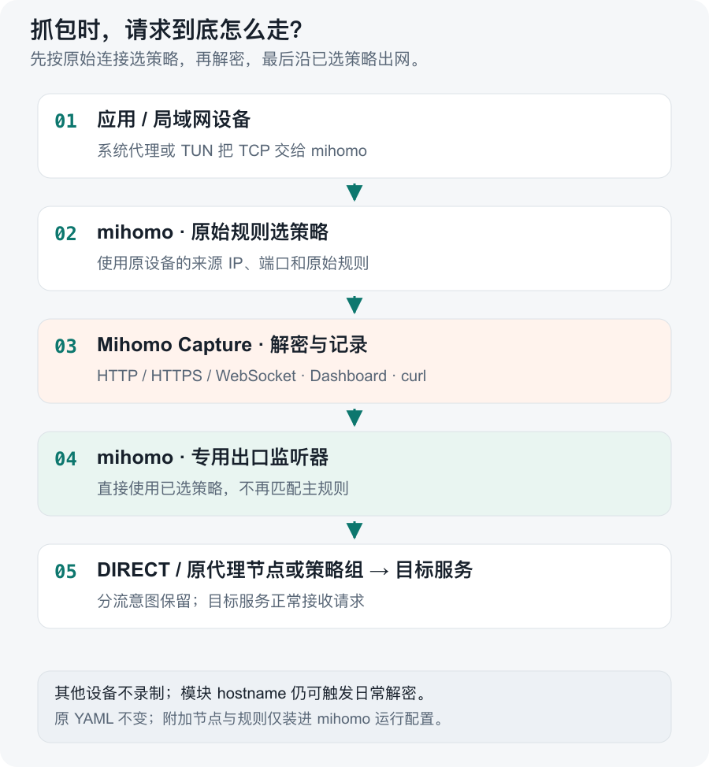

# mihomo 接入

[English](mihomo.md)

首次使用可以先看 [README 的接入图解](../README.zh-CN.md#怎么接入)。下面说明回源连接为什么保留原来的分流结果。

Mihomo Capture 与 mihomo 运行在同一电脑，读取它实际使用的 YAML，并通过 controller 的 `PUT /configs` 加载一份添加了抓包节点和监听器的运行配置。原 YAML 不会被写入。文件规则集位于 `gateway_state_dir`，mihomo 必须有权读取它们，这个目录应放在 mihomo home 下。

服务添加 `mihomo-capture-` 前缀的代理节点、规则集和子规则，以及一个只监听回环的 HTTP 出口。capture 通道接收选中设备的 TCP；每条 daily 通道接收启用了同一组模块的受信设备，只限这些模块的主机名，服务从通道名得知它对应哪一组模块。每条通道都复制一份原始规则和 sub-rules。mihomo 在连接来源信息还完整时选中原策略，转发到服务的 CONNECT 头携带策略 ID。服务解密和记录后通过出口监听器回到该策略，出口使用自己的子规则，不再匹配主规则。这也允许捕获来自 `127.0.0.1` 的本机连接而不循环进入抓包服务。

选择变化只更新文件规则集。首次非空选择时加载附加配置，带两条 daily 通道；在用的模块组合多于通道数时，服务以两倍的通道数重新加载一次。不再有设备使用的模块组合会保留它的通道 30 秒，再让给别的组合，这样 mihomo 在改动前一刻分出去的连接仍能拿到当时的模块。之后每五秒检查一次；如果 mihomo 自己重载过，下一次同步会基于原文件重新安装。因此修改 mihomo 配置后，应先按原有方式让 mihomo 重载。不要只改文件却保留另一份运行配置。

## 配置限制

mihomo 必须始终使用 `rule` 模式。抓包期间不要切换到 `global` 或 `direct`，也不要在客户端里手选 `mihomo-capture-` 前缀的内部节点。动态切换模式可能绕过出口子规则并形成回环；先停止服务并运行 `-remove-gateway`，再切模式。

服务拒绝无法保持分流含义的配置，包括 `PASS`、`PASS-RULE`，按来源选成员的 `load-balance` 组，select、fallback、url-test 以外的策略组，以及 `include-all` / `include-all-proxies`。这些选项可能把内部抓包节点纳入普通出网策略。应把组成员明确列出。已有 `mihomo-capture-` 名称、无规则、未知策略和出口端口冲突也会拒绝。先用 `-check` 检查兼容性。

这里需要的是 core 的 controller 和最终配置。项目不会读取某个桌面客户端的数据库，也不会自动猜测订阅转换和配置合并结果。会自动覆盖 core 配置的客户端可能与服务反复重载，需要关闭该行为或单独运行 core。

## 生命周期

每次启动先清空所有通道。停止和撤销信任使在途记录凭证失效，已有 TCP 连接可以继续到自然结束，停止录制不会主动断开它们。关闭服务则会断开服务持有的连接。清空记录不会停止抓包，新连接仍可产生新记录。

`-clear-gateway` 只清空选择，`-remove-gateway` 让 core 重载原配置并删除选择文件。后者应在服务退出后运行，否则下一轮同步会重新安装。服务卡死而进程仍在时，mihomo 仍把选中的流量交给它，需要重启服务。

网关模式只发现 IPv4 邻居，DHCP 重分配到下一次五秒刷新之间可能存在短暂的旧 IP 绑定。设备使用随机 MAC 后会出现为新设备，旧信任不会继承。

## 测试范围

原版 core 测试覆盖来源地址与端口选策略、REJECT、回环来源只经过服务一次、未选中来源、hostname 排除、按模块组合分出的 daily 通道及其扩容、server-first、半关闭、UDP 端口阻断，以及重载、清空和移除。测试不需要 TUN 或管理员权限，不验证真实应用的证书信任、桌面客户端配置合并或系统路由。
